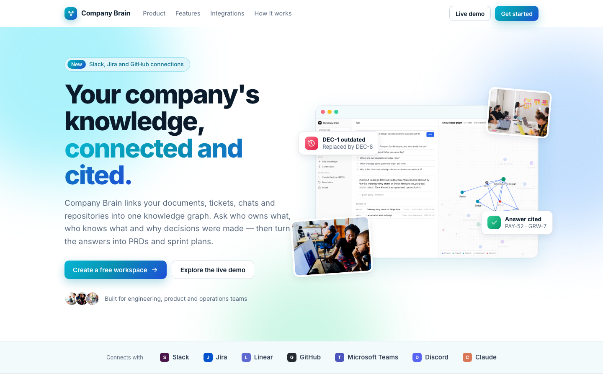
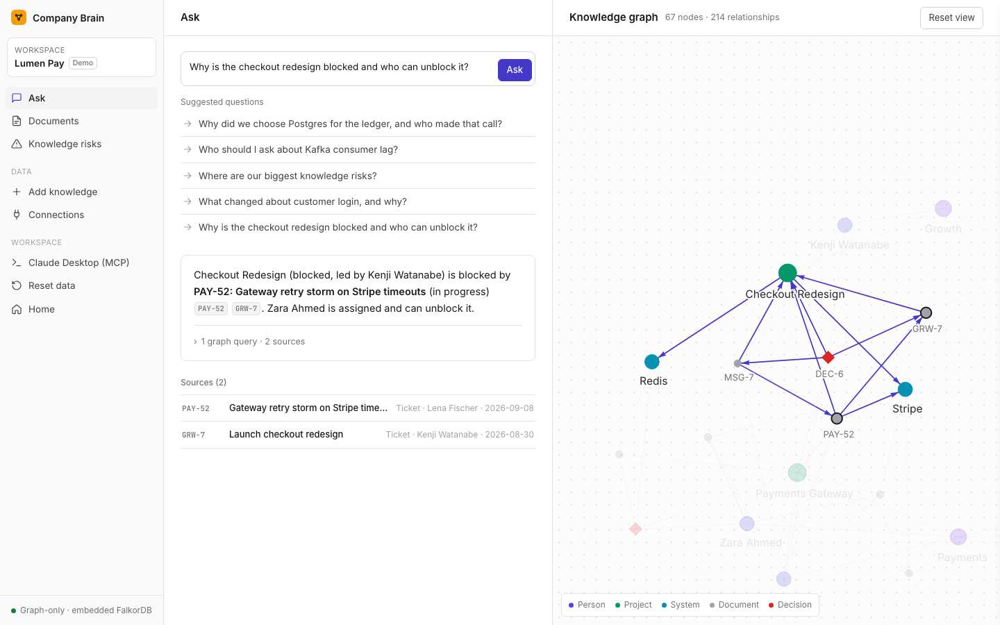
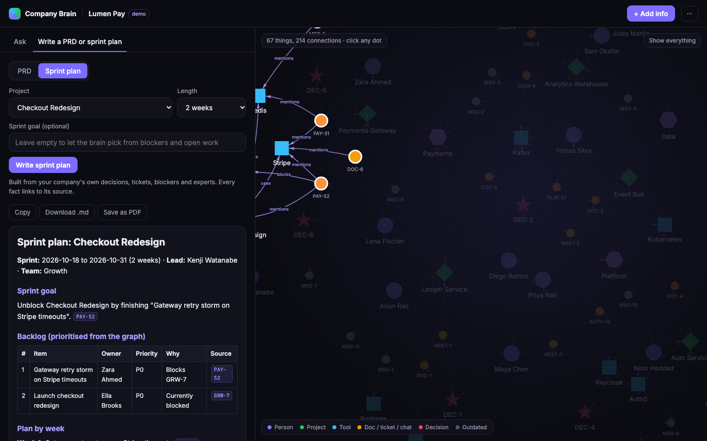
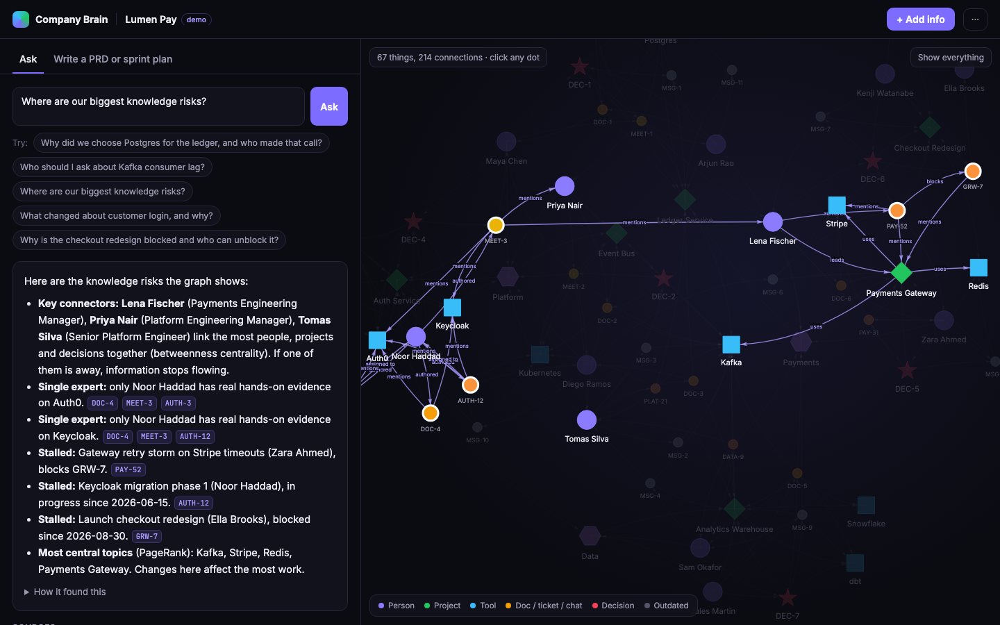
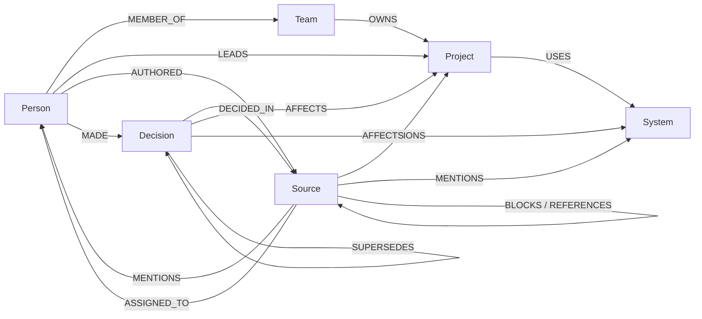
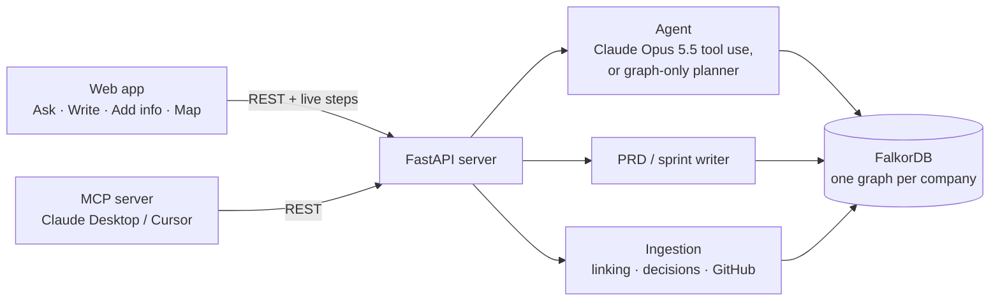

# Company Brain — Track 03 (WeMakeDevs × FalkorDB)

**Any company can turn its docs, tickets, meeting notes, chats and GitHub repos into one connected FalkorDB graph, then ask who owns what, who actually knows what, and why decisions were made, and generate a PRD or sprint plan from it. Every answer and every line is linked to its source.**

**Live demo:** [link goes here after deploy] — open the Lumen Pay demo, or create your own workspace. Nothing to install.





| Sprint plan built from the graph | Knowledge risks from graph algorithms |
|---|---|
|  |  |

## What it does

1. **Register your company.** You get a private workspace with its own FalkorDB graph and a secret access link.
2. **Bring your knowledge.** Paste docs, meeting notes, tickets and chats; upload `.txt`, `.md`, `.csv` or `.json`; **import a GitHub repo**; or **connect your tools** (below). Everything is linked to the right people, projects and tools automatically.
3. **Connect Slack and other platforms, in both directions.**
   - **Slack app:** messages in channels the bot is in flow in live, `/brain <question>` answers in Slack with sources, and recent channel history can be imported. No Slack app? Upload a Slack export `.zip`.
   - **Jira, Linear, GitHub webhooks,** plus anything via Zapier, Make or n8n (Teams, Notion, Google Docs, email): one private webhook URL per company.
   - **Notifications out** to Slack, Discord, Microsoft Teams or Google Chat: new and replaced decisions are announced, and any answer, PRD or sprint plan can be sent to the channel.
4. **Ask anything.** "Why did we choose Postgres?", "Who should I ask about Kafka?", "Why is checkout blocked?" The brain follows the connections, shows each step live, cites its sources, and highlights the path on the map.
5. **See who actually knows what.** Expertise comes from evidence (who wrote about it, who was assigned it, who colleagues thank), not from org charts, and it's shown next to formal ownership.
6. **Write a PRD or sprint plan** for any project in one click. Blockers are scheduled first, owners come from assignees or whoever has hands-on experience, risks are flagged, and every line is cited. Download as Markdown or save as PDF.
7. **Find knowledge risks** with FalkorDB's graph algorithms: key connectors, single points of failure, stalled work, and knowledge nobody is linked to.
8. **It stays current.** When a new message records a decision that replaces an older one, the old one is marked outdated. Mistakes can be removed or marked "not a decision", which restores whatever it replaced.
9. **Use it from Claude Desktop or Cursor** through the included MCP server.

A public demo company, **Lumen Pay** (12 people, 6 projects, 27 docs/tickets/chats, 7 decisions), lets judges try everything immediately.

## How we use FalkorDB

| FalkorDB feature | What it does here |
|---|---|
| **One graph per company** (`cb_<slug>`) | Each company is fully isolated; the registry graph stores only a hash of each access key |
| **Full-text indexes** on `Source(text, title)` and `Decision(title, summary)` | Retrieval: each question word is scored separately and the scores are added up, so items covering more of the question rank first |
| **Multi-hop Cypher** | Decision trails (`Decision-[:DECIDED_IN]->Source`, `-[:SUPERSEDES]->`), blockers (`Source-[:BLOCKS]->Source-[:MENTIONS]->Project`), expertise (`Person-[:AUTHORED]->Source-[:MENTIONS]->System`) |
| **`algo.betweenness`** | Key connectors: people on the most paths between knowledge |
| **`algo.pageRank`** | Central topics: projects and tools everything depends on |
| **`algo.WCC`** (connected components) | Unconnected knowledge: items linked to no person or project |
| **Read-only queries** (`GRAPH.RO_QUERY`) | Every query the agent runs is read-only, and write keywords are rejected, so the model can't change the graph |

### Graph model



### Architecture



## Connections

Open **Connect apps** in a workspace. Each company connects its own tools; the shared demo has connections switched off.

| Tool | Direction | How |
|---|---|---|
| Slack | In (live) + `/brain` answers | Copy the generated app manifest → api.slack.com/apps → *From a manifest* → install, then paste the bot token and signing secret. Every request is checked against the signing secret (HMAC, 5-minute window); Slack's retries and bot posts are ignored. |
| Slack history | In | "Import recent channel history" (channels the bot is in), or upload a Slack export `.zip`, which is parsed in the browser |
| Jira, Linear, GitHub | In | Point their webhooks at the private URL `/hooks/<workspace>/<token>`. Their native payloads are recognised. |
| Zapier, Make, n8n | In | POST `{"text","author","channel","kind"}` (or `{"items":[...]}`) to the same URL; this reaches Teams, Notion, Google Docs, email and more |
| Slack, Discord, Teams, Google Chat | Out | Incoming-webhook URL. Decisions are announced, and there's a "Send to channel" button on answers and documents. Only those chat hosts are allowed. |

Secrets are stored on the workspace's registry node, are never returned to the browser in full, and the webhook URL can be rotated.

## Quality

- **Accuracy check** (`python eval_qa.py`): 10 questions about the demo company, where each answer must contain the right facts and cite the right sources. **Graph-only mode: 10/10.** Run it with `ANTHROPIC_API_KEY` set to score Claude mode.
- **Tests** (`python -m pytest -q`): 21 tests. 9 cover connections: Slack signature checks (valid, wrong, expired), live Slack messages becoming knowledge and announcing decisions, `/brain` answering in channel, Jira, Linear, GitHub and generic webhooks, the chat-host allowlist, hidden secrets, and demo protection. The other 12 cover company isolation, access keys, people deduplication, linking without AI, decisions not over-detected, replace-and-undo of decisions, deletion, cited answers, sprint ordering, PRD sections, the graph algorithms, and the full API including live steps.
- **Scale:** importing 400 items takes under a second. Above 450 nodes the map shows an overview and loads just the part behind each answer.

## Use it from Claude Desktop (MCP)

`mcp_server.py` exposes `ask_company`, `list_projects`, `write_prd`, `write_sprint_plan` and `add_to_brain`. In the app, choose menu (···) → **Use in Claude Desktop** to copy a ready-made config, or write it yourself:

```json
{"mcpServers": {"company-brain": {"command": "python3", "args": ["/path/to/mcp_server.py"],
  "env": {"BRAIN_URL": "https://your-site.onrender.com", "BRAIN_WORKSPACE": "your-slug", "BRAIN_KEY": "your-key"}}}}
```

It needs `pip install mcp`, and works with mcp 1.x and 2.x.

## Deploy online (FalkorDB Cloud + Render, both free)

1. **FalkorDB Cloud:** create a free instance at https://app.falkordb.cloud, then copy its host, port, username and password.
2. **Render:** at https://dashboard.render.com choose **New → Blueprint** and pick this repo (it reads `render.yaml`).
3. Set `FALKORDB_HOST`, `FALKORDB_PORT`, `FALKORDB_USERNAME`, `FALKORDB_PASSWORD`; optionally `ANTHROPIC_API_KEY` (AI answers, AI-written docs, AI entity extraction) and `GITHUB_TOKEN` (higher GitHub rate limit). Deploy.
4. On first start the app builds the demo company in FalkorDB Cloud. Open the Render URL.

## Run locally (macOS)

```bash
python3 -m venv .venv && .venv/bin/pip install -r requirements.txt -r requirements-dev.txt
.venv/bin/python server.py            # http://localhost:8000, embedded FalkorDB
.venv/bin/python -m pytest -q          # tests
.venv/bin/python eval_qa.py            # accuracy check
```

Without `ANTHROPIC_API_KEY`, a rule-based planner calls the same graph tools and documents are assembled from templates, so everything still works. With a key, Claude Opus 5.5 plans the tool calls, writes the answers and documents, and spots new people, projects and tools in pasted text.

Deep links: `/w/demo?ask=Who owns checkout?` or `/w/demo?write=sprint&project=project:checkout`.

## Files

| File | Purpose |
|---|---|
| `server.py` | FastAPI app: workspaces, ask (with live steps), generate, add/import/delete, map |
| `brain_ingest.py` | Adds people, projects and tools; adds knowledge; links mentions, @handles and known technologies; detects decisions and replaces outdated ones; delete and undo; bulk import; demo build |
| `brain_tools.py` | Agent tools: `search_knowledge`, `entity_profile`, `who_knows`, `decision_trail`, `run_cypher`, plus the trace |
| `brain_agent.py` | Claude agent (tool runner) and the graph-only planner; suggested questions |
| `brain_docs.py` | PRD and sprint plan generator |
| `brain_insights.py` | Knowledge risks using `algo.betweenness`, `algo.pageRank`, `algo.WCC` |
| `brain_github.py` | Import issues, pull requests and comments from a public GitHub repo |
| `integrations.py` | Slack (events, slash command, history), incoming webhooks (Jira, Linear, GitHub, generic) and chat notifications (Slack, Discord, Teams, Google Chat) |
| `workspaces.py` | Company registration and access keys (hashed) |
| `mcp_server.py` | MCP server for Claude Desktop / Cursor |
| `company_data.py` | Demo company "Lumen Pay" (fictional) |
| `static/` | `landing.html` (home), `index.html` + `app.js` (workspace app) |
| `eval_qa.py`, `tests/` | Accuracy check and tests |

## Limitations (honest)

- **Access is a secret link,** with no accounts. A lost link can't be recovered, and the setup screens say so. Real sign-in is the next step.
- **Rate limits are kept in memory,** so they reset when the server restarts, and each server instance has its own.
- **Without an AI key,** new items are linked only to people, projects and tools the brain already knows about (plus @mentions and about 100 common technologies). Decisions are found by phrases like "we decided" or "we're moving", and they can be undone with "Not a decision".
- **Connection secrets** are stored as-is in the registry graph. Production should encrypt them or use a secrets manager. Slack setup is one app per company (a manifest is generated), not a one-click "Add to Slack" listing.
- **GitHub import** reads the 100 most recently updated issues and pull requests and their recent comments, from public repos only.

## 3-minute demo script

1. **Problem (20s).** Company knowledge is scattered across docs, tickets, chat and GitHub. People can't find who knows what or why a choice was made, and every sprint plan starts from scratch.
2. **Ask (40s).** In the demo, tap "Who should I ask about Kafka?". The steps appear live, then a cited answer, and the map lights up. Tomas *knows* Kafka even though Priya *owns* the Event Bus.
3. **Risks (20s).** Tap "Where are our biggest knowledge risks?". Graph algorithms find key connectors, single points of failure and stalled work.
4. **Plan (30s).** In **Write**, choose Sprint plan for Checkout Redesign. The blocker PAY-52 comes first, owners are filled in, and every line is cited.
5. **Stays current (25s).** **+ Add info** → post the prefilled message from Maya. DEC-1 is marked outdated, and the Ledger sprint plan now includes the CockroachDB rollout.
6. **Connect (20s).** Open **Connect apps**: show the Slack manifest, the webhook URL for Jira, Linear and GitHub, and channel notifications. Upload a Slack export zip and ask about it right away.
7. **Your company (30s).** Create a workspace and import a GitHub repo (e.g. `FalkorDB/falkordb-py`). Within seconds it knows the contributors, the experts and the open work, and can write a sprint plan.
8. **Close (15s).** One FalkorDB graph per company, cited answers and plans, and knowledge that stays current. Also available inside Claude through MCP.

Before recording: menu (···) → Reset data in the demo.
