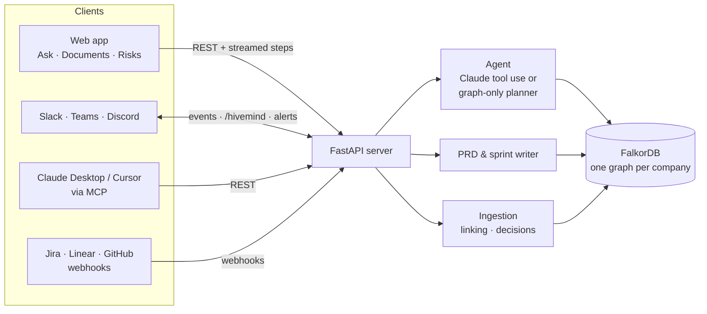
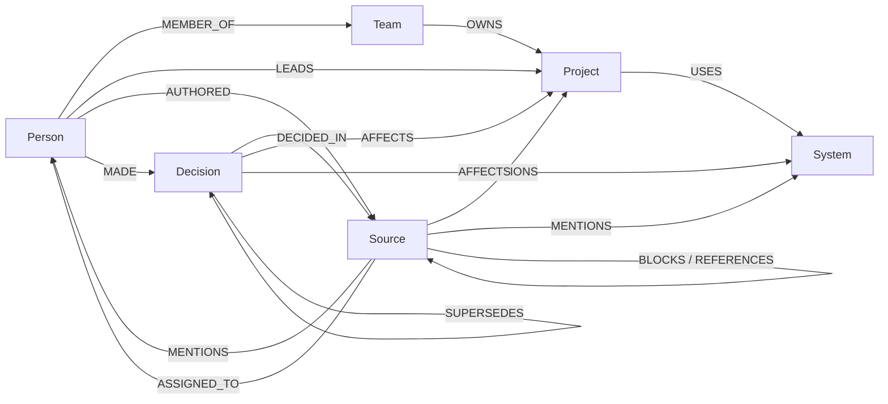

<div align="center">


# Hivemind

**The memory your company never had.**

A knowledge graph agent that connects a company's documents, tickets, chats and repositories in FalkorDB.<br>
It answers who owns what, who knows what and why decisions were made — with sources — and turns that knowledge into PRDs and sprint plans.


**WeMakeDevs × FalkorDB Hackathon · Track 03 — Company Brain**

[For judges](#for-judges) · [Key Cypher queries](#key-cypher-queries) · [Getting started](#getting-started) · [Features](#features) · [Architecture](#architecture) · [How we use FalkorDB](#how-we-use-falkordb) · [Run offline](#run-offline-and-self-host)

</div>

<!-- TODO: add the live demo URL and YouTube link once published -->


## For judges

**Watch:** [demo video (3:30, 1080p)](https://github.com/Utkarsh2730/hivemind/releases/latest/download/hivemind-demo.mp4) — also playable offline once downloaded.

**Run it yourself, fully offline** — no accounts, API keys or internet needed after download:

1. Install [Docker Desktop](https://www.docker.com/products/docker-desktop/) and start it.
2. Download **[hivemind-offline.tar.gz](https://github.com/Utkarsh2730/hivemind/releases/latest/download/hivemind-offline.tar.gz)** from the [latest release](https://github.com/Utkarsh2730/hivemind/releases/latest) — both Docker images and an installer in one file.
3. In a terminal:
   ```bash
   tar -xzf hivemind-offline.tar.gz
   cd bundle && ./install.sh
   ```
4. Open **http://localhost:8000** → **Try the live demo**. Suggested path: ask a suggested question, open **Knowledge risks**, generate a **sprint plan** in Documents, then **Create a workspace** to try it with your own data.

Every release bundle is built and verified automatically: GitHub Actions starts the stack, reinstalls the bundle from scratch as above, and checks cited answers, graph-algorithm insights and sprint plans (`scripts/smoke_test.sh`). Offline, Hivemind runs in graph-only mode; Claude, GitHub import and Slack are optional extras that need internet.

To stop it: `docker compose down` in the `bundle` folder.

---

## The problem

A company's knowledge is spread across Confluence pages, Jira tickets, Slack threads and pull requests. The facts exist, but the **connections** between them do not:

- New engineers ask the same few people the same questions.
- Decisions are re-argued because nobody can find who made them, when, or why — or whether they still hold.
- Ownership on paper differs from who actually knows a system, and nobody notices until that person is on leave.
- Every sprint plan and PRD starts from a blank page, even though the tickets, blockers and decisions are already written down.

Search tools return documents. Teams need **answers that follow relationships**: person → ticket → project → system → decision.

## The solution

Hivemind models a company as a graph in **FalkorDB** — people, teams, projects, systems, documents, tickets, messages and decisions — and gives an agent tools to traverse it.

| Ask | Get |
|---|---|
| *"Who should I ask about Kafka consumer lag?"* | **Tomas Silva**, ranked from evidence (he wrote the consumer runbook and library and owns the Kafka upgrade), shown next to formal owner Priya Nair. Cites `DOC-3`, `PLAT-21`, `MSG-2`, `MSG-3`. |
| *"What changed about customer login, and why?"* | **Auth0 → Keycloak**: DEC-3 is marked outdated and replaced by DEC-4 (cost at 2M MAU, EU data residency), with the meeting, RFC and message that record it. |
| *"Why is the checkout redesign blocked?"* | **PAY-52** (Stripe retry storm) blocks GRW-7; Zara Ahmed is assigned and can unblock it. |
| *Sprint plan for Checkout Redesign* | A prioritised backlog: the blocker first, owners from assignees or expertise, risks flagged, every line cited. |


## Features

**Knowledge**
- **Cited answers.** Every claim links to the document, ticket or message it came from; the graph highlights the exact path used, and each search step streams live.
- **Expertise from evidence.** People are ranked by what they authored, were assigned and were credited for, separately from formal ownership.
- **Decision history.** Decisions are traced to the meeting or thread where they were made. When a new decision replaces an old one, the old one is marked outdated automatically — and can be restored if detection was wrong.
- **Knowledge risks.** FalkorDB graph algorithms find key connectors, systems only one person knows, stalled work and unlinked knowledge.

**Planning**
- **PRDs and sprint plans** generated from a project's live decisions, tickets, blockers and experts. Blockers are scheduled first and owners come from assignments or hands-on expertise. Export to Markdown or PDF, or post to a channel.

**Ingestion and integrations**
- Paste or upload documents, CSV and JSON; import a **GitHub** repository's issues, pull requests and comments.
- **Slack** app: live message capture, `/hivemind <question>` in Slack, channel history import, or a Slack export `.zip`.
- **Jira, Linear and GitHub** webhooks; **Zapier, Make and n8n** for Notion, email and others.
- Decision announcements and shared answers to **Slack, Microsoft Teams, Discord and Google Chat**.
- **MCP server** so Claude Desktop and Cursor can query the company graph.

**Platform**
- **Multi-tenant:** any company can register; each workspace is a separate FalkorDB graph with its own access key.
- **Works without AI:** a graph-only planner answers all demo questions correctly (10/10); with an Anthropic key, Claude plans the tool calls and writes the answers.
- **Deploy anywhere:** FalkorDB Cloud + Render, Docker Compose, or a fully offline, air-gapped bundle.

| Sprint plan built from the graph | Knowledge risks from graph algorithms |
|---|---|
|  |  |

## Track 03 alignment

| Track 03 focus | How Hivemind delivers it |
|---|---|
| Knowledge from docs, tickets and chats in one graph | Documents, tickets, messages, meetings, GitHub issues/PRs and Slack history become `Source` nodes linked to people, projects and systems automatically (mentions, @handles, ~100 known technologies, and AI extraction when a key is set). |
| Who owns what, and who knows what | Ownership comes from `OWNS`/`LEADS` edges; expertise is scored from `AUTHORED`, `ASSIGNED_TO`, colleague mentions and `MADE` decisions — and the two are shown side by side. |
| Tracing decisions back to their source | `Decision -[:DECIDED_IN]-> Source`, `Person -[:MADE]-> Decision`, `Decision -[:SUPERSEDES]-> Decision`. |
| Keeping knowledge current as things change | Live ingestion from the UI, Slack, webhooks and MCP; replaced decisions become outdated; mistakes can be removed or reverted. |
| Answers with clear sources | Every answer and every generated document cites `[KEY]` sources, which open the original text and focus the graph. |

## Architecture



**Graph model**



**Agent tools:** `search_knowledge` (full-text), `entity_profile`, `who_knows` (expertise ranking), `decision_trail`, `company_insights` (graph algorithms) and read-only `run_cypher`.

**Tech stack:** FalkorDB · Python 3.12 · FastAPI · Anthropic Claude (optional) · vis-network · MCP · Docker.

## How we use FalkorDB

| FalkorDB capability | Use in Hivemind |
|---|---|
| **Multiple graphs** | One isolated graph per company (`cb_<workspace>`), plus a registry graph that stores only SHA-256 hashes of access keys. |
| **Full-text indexes** | On `Source(text, title)` and `Decision(title, summary)`. Each question term is scored separately and the scores combined, so items covering more of the question rank first. |
| **Multi-hop Cypher** | Decision trails, blocker chains (`Source-[:BLOCKS]->Source-[:MENTIONS]->Project`), expertise (`Person-[:AUTHORED]->Source-[:MENTIONS]->System`). |
| **`algo.betweenness`** | Key connectors — people on the most paths between knowledge. |
| **`algo.pageRank`** | Central topics — the projects and systems most work depends on. |
| **`algo.WCC`** | Unconnected knowledge — items linked to no person or project. |
| **Read-only queries** | Every agent query runs through `GRAPH.RO_QUERY`, and write keywords are rejected, so the model cannot modify the graph. |

## Key Cypher queries

These queries are the product's core logic (from `brain_tools.py`, `brain_insights.py`, `brain_ingest.py` and `brain_docs.py`). Parameters such as `$k` are passed in, and every agent query runs read-only.

**Who actually knows a system** — evidence-weighted expertise (`who_knows`):
```cypher
// authored about it (weight 3)
MATCH (p:Person)-[:AUTHORED]->(s:Source)-[:MENTIONS]->(e) WHERE e.key IN $k RETURN p.key AS person, s.key AS ev
// assigned work on it (weight 2)
MATCH (s:Source)-[:ASSIGNED_TO]->(p:Person) MATCH (s)-[:MENTIONS]->(e) WHERE e.key IN $k RETURN p.key AS person, s.key AS ev
// named or thanked by colleagues in that context (weight 2)
MATCH (a:Person)-[:AUTHORED]->(s:Source)-[:MENTIONS]->(p:Person), (s)-[:MENTIONS]->(e)
WHERE e.key IN $k AND a <> p RETURN p.key AS person, s.key AS ev
// made decisions about it (weight 2)
MATCH (p:Person)-[:MADE]->(d:Decision)-[:AFFECTS]->(e) WHERE e.key IN $k RETURN p.key AS person, d.key AS ev
// formal owners, shown for contrast
MATCH (l:Person)-[:LEADS]->(p:Project) WHERE p.key IN $k OR (p)-[:USES]->(:System {key: $k[0]}) RETURN l.name, p.name
```

**Decision trail** — where a decision was made, by whom, and what replaced what (`decision_trail`):
```cypher
MATCH (d:Decision)-[:AFFECTS]->(e) WHERE e.key IN $k RETURN DISTINCT d.key
MATCH (p:Person)-[:MADE]->(:Decision {key: $k}) RETURN p.name, p.role
MATCH (:Decision {key: $k})-[:DECIDED_IN]->(s) OPTIONAL MATCH (a)-[:AUTHORED]->(s) RETURN s.key, s.title, a.name
MATCH (n)-[:SUPERSEDES]->(:Decision {key: $k}) RETURN n.key, n.title
```

**What blocks a project** (`entity_profile`, sprint planning):
```cypher
MATCH (b:Source)-[:BLOCKS]->(s:Source)-[:MENTIONS]->(:Project {key: $k})
OPTIONAL MATCH (b)-[:ASSIGNED_TO]->(a)
RETURN b.key, b.title, b.status, a.name, s.key AS blocks
```

**Keeping knowledge current** — a new decision replaces an older one (`add_knowledge`):
```cypher
MATCH (d:Decision {status: 'active'})-[:AFFECTS]->(e) WHERE e.key IN $affects RETURN d.key, d.title, collect(e.key)
MATCH (n:Decision {key: $new}), (o:Decision {key: $old}) SET o.status = 'superseded' MERGE (n)-[:SUPERSEDES]->(o)
```

**Retrieval** — full-text search, scored per term (`search_knowledge`):
```cypher
CALL db.idx.fulltext.createNodeIndex('Source', 'text', 'title')
CALL db.idx.fulltext.queryNodes('Source', $term) YIELD node, score RETURN node.key, score
```

**Graph algorithms** — knowledge risks (`brain_insights.py`):
```cypher
// key connectors: people on the most paths between knowledge
CALL algo.betweenness({nodeLabels: ['Person','Source','Project','System','Decision'],
  relationshipTypes: ['AUTHORED','MENTIONS','LEADS','USES','MADE','AFFECTS','DECIDED_IN','ASSIGNED_TO']})
YIELD node, score WHERE node:Person RETURN node.name, score ORDER BY score DESC LIMIT 5
// central topics
CALL algo.pageRank(null, null) YIELD node, score WHERE node:Project OR node:System
RETURN node.name, score ORDER BY score DESC LIMIT 5
// unconnected knowledge: items outside the main component
CALL algo.WCC({nodeLabels: ['Person','Team','Project','System','Source','Decision']})
YIELD node, componentId RETURN componentId, collect(node.key), count(node) ORDER BY count(node) DESC
```

## Getting started

### Try the demo locally (one command)

```bash
git clone https://github.com/Utkarsh2730/hivemind.git && cd hivemind
docker compose up -d
```

Open **http://localhost:8000** and choose **Try the live demo** (Lumen Pay: 12 people, 6 projects, 27 documents/tickets/messages, 7 decisions), or create your own workspace.

### Deploy to the cloud (free tiers)

1. Create a free instance on **[FalkorDB Cloud](https://app.falkordb.cloud)** and note its host, port, username and password.
2. On **[Render](https://dashboard.render.com)**, choose **New → Blueprint** and select this repository (`render.yaml` is included).
3. Set `FALKORDB_HOST`, `FALKORDB_PORT`, `FALKORDB_USERNAME`, `FALKORDB_PASSWORD`, and optionally `ANTHROPIC_API_KEY` and `GITHUB_TOKEN`.
4. Deploy. On first start the app creates the demo workspace in FalkorDB Cloud.

### Configuration

| Variable | Purpose | Default |
|---|---|---|
| `FALKORDB_HOST` / `FALKORDB_PORT` | FalkorDB server; leave unset on macOS to use embedded FalkorDB | — / `6379` |
| `FALKORDB_USERNAME` / `FALKORDB_PASSWORD` / `FALKORDB_SSL` | Credentials and TLS for hosted FalkorDB | — |
| `ANTHROPIC_API_KEY` | Enables Claude for answers, documents and entity extraction | graph-only |
| `GITHUB_TOKEN` | Higher GitHub API rate limit for repository import | unauthenticated |
| `PUBLIC_URL` | Public base URL used in Slack and webhook URLs | from request |
| `PORT` / `HIVEMIND_PORT` | App port (server / Docker host) | `8000` |

## Run offline and self-host

Hivemind runs entirely on your own machine or server: no cloud accounts and no internet at runtime. Fonts, the graph library and images are bundled with the app, and FalkorDB runs alongside it in Docker.

| Works offline | Needs internet (optional) |
|---|---|
| Cited answers (graph-only mode), PRDs and sprint plans, knowledge risks | AI-written answers and documents (Claude) |
| Paste and file uploads, Slack export `.zip`, workspaces, graph view | GitHub import, Slack app, chat notifications, external webhooks |

**With Docker (recommended)**

1. Install [Docker Desktop](https://www.docker.com/products/docker-desktop/) (Mac/Windows) or Docker Engine with the compose plugin (Linux).
2. Download this repository (**Code → Download ZIP**) or `git clone` it, then in that folder run:
   ```bash
   docker compose up -d
   ```
3. Open **http://localhost:8000**. Colleagues on the same network can use `http://<server-ip>:8000`. FalkorDB's own browser is at http://localhost:3000.

| Task | Command |
|---|---|
| Stop / start (data is kept) | `docker compose stop` / `docker compose start` |
| Status and logs | `docker compose ps` / `docker compose logs hivemind` |
| Update to a new version | `docker compose up -d --build` |
| Remove containers (keep data) / remove everything | `docker compose down` / `docker compose down -v` |

Optional settings go in a `.env` file next to `docker-compose.yml`, for example `HIVEMIND_PORT=8080` or `ANTHROPIC_API_KEY=...`.

**Air-gapped machines (no internet at all)**

Download the prebuilt **[hivemind-offline.tar.gz](https://github.com/Utkarsh2730/hivemind/releases/latest/download/hivemind-offline.tar.gz)** (or build it yourself with `./scripts/package_offline.sh` on a machine with Docker and internet), copy it over, then:

```bash
tar -xzf hivemind-offline.tar.gz && cd bundle && ./install.sh
```

**macOS without Docker:** `./scripts/run_local.sh` runs with embedded FalkorDB (internet is needed once to install Python packages).

<details>
<summary><b>Back up and restore data</b></summary>

```bash
# Back up
docker compose exec falkordb redis-cli BGSAVE
docker compose cp falkordb:/data ./hivemind-backup

# Restore
docker compose stop falkordb
docker compose cp ./hivemind-backup/. falkordb:/data
docker compose start falkordb
```
</details>

<details>
<summary><b>Troubleshooting</b></summary>

- **Page does not open** — `docker compose ps` should show both services running/healthy; check `docker compose logs hivemind`.
- **Port already allocated** — set `HIVEMIND_PORT=8080` in `.env` and open http://localhost:8080.
- **Answers say "graph-only"** — expected offline; add `ANTHROPIC_API_KEY` only on machines with internet.
- **Lost a workspace access link** — links cannot be recovered; store them safely.
</details>

## Integrations

| Tool | Direction | Setup |
|---|---|---|
| Slack | In (live) and out (`/hivemind`, alerts) | Copy the generated app manifest → api.slack.com/apps → *From a manifest* → paste the bot token and signing secret. Requests are verified with the signing secret (HMAC, 5-minute window); retries and bot posts are ignored. |
| Slack history | In | Import recent history from channels the bot is in, or upload a Slack export `.zip` (parsed in the browser). |
| Jira · Linear · GitHub | In | Point webhooks at the workspace's private URL `/hooks/<workspace>/<token>`; native payloads are recognised. |
| Zapier · Make · n8n | In | POST `{"text", "author", "channel", "kind"}` to the same URL (reaches Teams, Notion, email and more). |
| Slack · Teams · Discord · Google Chat | Out | Incoming-webhook URL; decisions are announced and answers/documents can be shared. Only these hosts are allowed. |
| Claude Desktop · Cursor | Both | `mcp_server.py` exposes `ask_company`, `list_projects`, `write_prd`, `write_sprint_plan` and `add_to_brain`. |

<details>
<summary><b>MCP configuration</b></summary>

In the app, choose **Claude Desktop (MCP)** in the sidebar to copy a ready-made configuration, or add:

```json
{"mcpServers": {"hivemind": {"command": "python3", "args": ["/path/to/mcp_server.py"],
  "env": {"BRAIN_URL": "http://localhost:8000", "BRAIN_WORKSPACE": "your-workspace", "BRAIN_KEY": "your-access-key"}}}}
```

Requires `pip install mcp` (1.x or 2.x).
</details>

## Quality and testing

| Check | Result |
|---|---|
| Accuracy (`python eval_qa.py`) | **10/10** demo questions answered with the required facts and sources (graph-only mode). Set `ANTHROPIC_API_KEY` to score Claude mode. |
| Automated tests (`python -m pytest -q`) | **21 passing** — workspace isolation, access keys, deduplication, decision detection and reversal, deletion, cited answers, sprint ordering, PRD structure, graph algorithms, full API with streaming, Slack signature verification and slash command, Jira/Linear/GitHub/generic webhooks, notification host allowlist, secret masking. |
| Scale | 400 items imported in under a second; above 450 nodes the graph view shows an overview and loads only the subgraph behind each answer. |
| Real data | Importing `FalkorDB/falkordb-py` from GitHub produced 61 items from 18 contributors, expert rankings and a sprint plan from open issues. |
| Offline | Both pages render with all external hosts blocked; no runtime requests leave the server. |
| Continuous integration | Every push runs the unit tests and accuracy check against FalkorDB, starts the Docker Compose stack, builds the offline bundle, reinstalls it from scratch and runs `scripts/smoke_test.sh` against it. |

## Security and privacy

- Each company's data lives in its own FalkorDB graph; only SHA-256 hashes of access keys are stored.
- Agent queries are read-only; Slack requests are signature-verified; outgoing notifications are restricted to known chat hosts.
- Connection secrets are never returned to the browser in full, and webhook URLs can be regenerated.
- Public endpoints are rate-limited and size-capped.

## Project structure

| Path | Description |
|---|---|
| `server.py` | FastAPI app: workspaces, ask (streamed), documents, ingestion, integrations, graph API |
| `brain_agent.py` · `brain_tools.py` | Claude tool-use agent, graph-only planner and graph tools |
| `brain_ingest.py` | Entity linking, decision detection and supersession, bulk import, demo data build |
| `brain_docs.py` · `brain_insights.py` | PRD/sprint generation · graph-algorithm insights |
| `brain_github.py` · `integrations.py` | GitHub import · Slack, webhooks and chat notifications |
| `workspaces.py` · `graph_db.py` | Tenant registry and access keys · FalkorDB connection (server or embedded) |
| `mcp_server.py` | MCP server for Claude Desktop and Cursor |
| `static/` | Landing page, workspace app and bundled assets |
| `tests/` · `eval_qa.py` | Test suite · accuracy evaluation |
| `Dockerfile` · `docker-compose.yml` · `scripts/` · `render.yaml` | Self-hosting, offline packaging and cloud deployment |
| `docs/` | Screenshots and the [demo script](docs/DEMO_SCRIPT.md) |
| `track1_blast_radius/` | Earlier Track 01 prototype, kept for reference (not part of this submission) |

## Limitations and roadmap

| Today | Next |
|---|---|
| Workspace access is a private link; lost links cannot be recovered. | SSO sign-in and roles. |
| Connection secrets are stored unencrypted in the registry graph. | Encryption at rest or a secrets manager. |
| Rate limits are in memory, per server instance. | Shared limits in FalkorDB or Redis. |
| Without an AI key, linking relies on known names, @mentions and a technology list. | Local embedding model for semantic linking offline. |
| Slack setup is one app per company via a generated manifest. | One-click "Add to Slack" distribution. |
| GitHub import reads the 100 most recently updated issues/PRs of public repos. | Pagination, private repos, and Confluence/Notion connectors. |

## AI assistance disclosure

As the hackathon rules require, I disclose that this project was built with an AI coding assistant: **Anthropic's Claude (via Claude Code)**. It helped write and debug code, tests, UI and documentation, and recorded the demo video narration (macOS text-to-speech). I chose the track and the problem, directed the product and design decisions through each iteration, and reviewed and tested the result. The Cypher queries, graph model and architecture are documented above, and I can walk through them.

## Credits

Built for the **WeMakeDevs × FalkorDB Hackathon** by **Utkarsh Sonthalia**.
Powered by [FalkorDB](https://www.falkordb.com). Graph rendering by [vis-network](https://visjs.github.io/vis-network/). Fonts: Fraunces, Inter and JetBrains Mono (SIL Open Font License). Photos from [Unsplash](https://unsplash.com). The demo company, Lumen Pay, and all its people and data are fictional.
